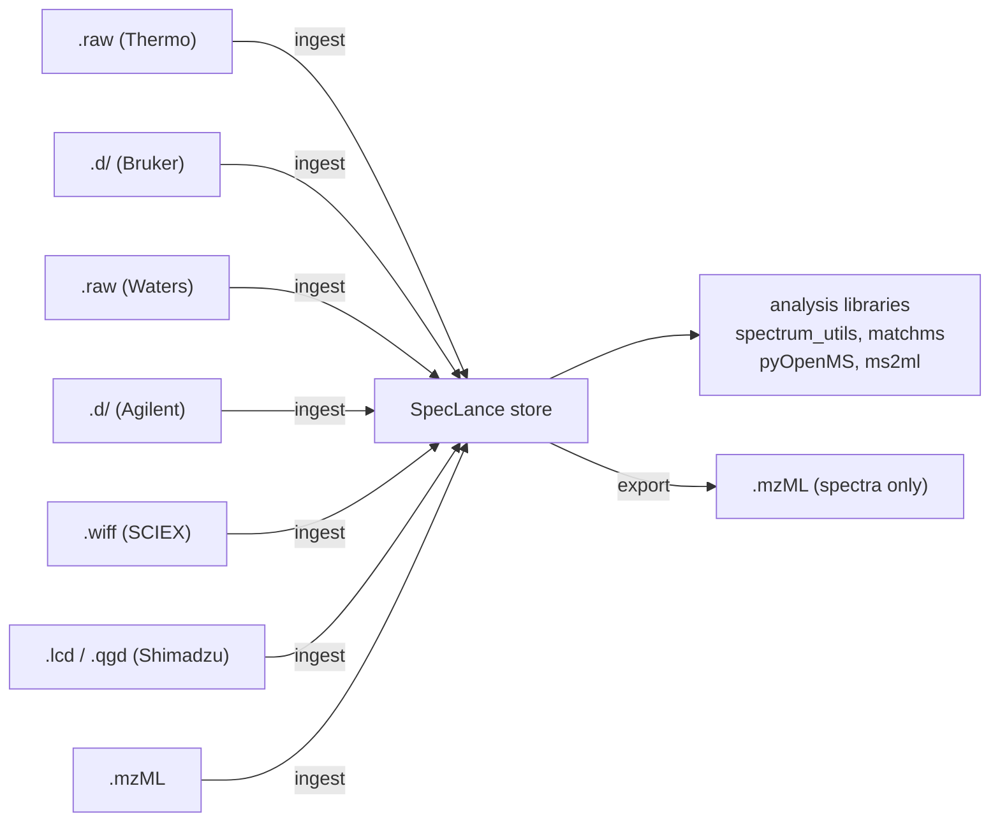

# SpecLance

[](https://github.com/Sigilweaver/SpecLance/actions/workflows/ci.yml)
[](LICENSE)
[](https://www.rust-lang.org)

> Part of the [OpenMassSpec](https://sigilweaver.app/openmassspec/docs/)
> stack for mass spectrometry raw-file access. SpecLance is the columnar
> storage layer; vendor readers feed it through
> [openmassspec-io](https://github.com/Sigilweaver/OpenMassSpec).

A fast, columnar, memory-mapped mass spectrometry data store powered by [Lance].

SpecLance is a **storage format**, not an analysis framework. It ingests mzML
and vendor raw files into a Lance store that is faster to read, cheaper to
seek, and can hold many runs in a single directory.

It is not a drop-in replacement for mzML today: mzML export is lossy (see
[Known limitations](#known-limitations)). Keep your source files.

## Status

Alpha. APIs and the on-disk schema may break without notice until 1.0.

What works today:

- Ingest `.mzML` (streaming) into a store with `runs`, `spectra`, and
  `chromatograms` tables.
- Ingest vendor raw data from all six formats `openmassspec-io` supports:
  Thermo `.raw`, Bruker timsTOF `.d`, Waters `.raw`, Agilent MassHunter
  `.d`, SCIEX `.wiff`, and Shimadzu LabSolutions `.lcd` / `.qgd`. Vendor
  ingest is off by default; build with `--features all-vendors`.
- Scalar indexes on `run_id`, `scan_num`, `rt`, and `ms_level`, and a
  retention-time window query (CLI `query`, Rust `Store::query_window`,
  Python `Store.query_window`).
- Export a run back to mzML (spectra only; see below).
- Python bindings that return plain `dict` / `list` objects.

### Known limitations

- **Export is lossy.** `speclance export` writes spectra only. It does not
  emit chromatograms, the stored `cv_params` blobs, or the verbatim
  `run_metadata` blocks. The output is a valid mzML for the spectra it
  carries, not a copy of the source.
- **MS-Numpress is not supported.** Ingest stops with an error on any
  Numpress-encoded array. Only uncompressed and zlib arrays are read.
- **`scan_num` does not always match the source.** For mzML ingest it is
  the spectrum `index` + 1, not the scan number in the nativeID. The
  original nativeID is kept in `native_id`.
- **One run, one ingest.** Re-ingesting a run that is already in the store
  is refused. The `run_id` is derived from the path string and file size,
  so the same file reached by a different path is not detected.
- **No m/z index or m/z query.** Queries filter on run, retention time, and
  MS level only.
- **No PyArrow / Polars output.** The Python API returns `dict`s and lists.
- All runs share one set of tables; there is no per-run dataset layout.

## Vision



There are three usage modes:

1. **Ingest from vendor format.** `openmassspec-io` parses the proprietary
   files (Thermo, Bruker, Waters, Agilent, SCIEX, Shimadzu) and SpecLance
   writes the store. No vendor SDK, no Wine, no COM interop. Requires a
   build with `--features all-vendors`.
2. **Ingest from mzML.** Parse existing mzML files and write a SpecLance
   store. This is the zero-friction on-ramp for labs that already have mzML
   pipelines.
3. **Export to mzML.** Write a run from a SpecLance store back out as mzML.
   Today this carries spectra and their typed fields only; chromatograms,
   extra CV params, and run-level metadata are dropped. A lossless
   `mzML -> SpecLance -> mzML` roundtrip was the original goal and is not
   met.

## Why Not mzML?

mzML is the HUPO-PSI community standard and it is well-supported, but it has
structural properties that make it expensive at scale:

- It is XML, which means sequential parsing. Seeking to scan 50,000 out of
  200,000 requires either re-parsing from the start or maintaining an index
  file (mzML.index / mzMLb).
- Every peak array is Base64-encoded inline in the XML, which inflates size
  and requires a decode step before any numerical work.
- Cross-run queries (e.g., "all MS2 spectra with precursor 445.22 +/- 10 ppm
  across 40 LC-MS runs") require loading and parsing each file independently.
- Profile-mode Orbitrap runs routinely exceed 1 GB. TimsTOF PASEF runs can
  reach 10-20 GB per acquisition.

Lance stores data as Apache Arrow columns in memory-mapped files. Filtering
by retention time, MS level, or precursor m/z touches only the relevant
columns, not the peak arrays. A region scan that would require parsing an
entire mzML file can be answered by reading a fraction of the bytes.

## Architecture

```
speclance-core/     Arrow schema definitions, LanceDB table management,
                   shared types (Spectrum, Chromatogram, Run).

speclance-ms/       mzML reader (quick-xml) and writer, plus a vendor
                   adapter over openmassspec-io (feature `vendors` /
                   `all-vendors`). Each source is normalised into the
                   common speclance_core::Spectrum type.

speclance-cli/      `speclance` binary.
                     ingest   - write a SpecLance store from mzML or,
                                with --features all-vendors, vendor files
                     runs     - list runs in a store
                     index    - build the default scalar indexes
                     query    - filter one run's spectra by RT / MS level
                     export   - write a run back to mzML (spectra only)

speclance-py/       Python bindings (PyO3 + maturin): Store.open,
                   ingest_mzml, create_default_indexes, runs,
                   query_window, chromatograms. mzML ingest only.
```

```bash
cargo build --release -p speclance-cli                          # mzML only
cargo build --release -p speclance-cli --features all-vendors   # + vendors

speclance ingest --store ./store run.mzML
speclance index --store ./store
speclance runs --store ./store
speclance query --store ./store --run-id <id> --rt-min 30 --rt-max 35 --ms-level 2
speclance export --store ./store --run-id <id> --out out.mzML
```

Cross-run commands (`xic`, `compare`) are not implemented.

## Schema

### `runs` table

One row per ingested file. All runs share the same three tables.

| column           | Arrow type | notes                                   |
|------------------|------------|-----------------------------------------|
| run_id           | Utf8       | SHA-256 of source path + size (16 hex)  |
| source_path      | Utf8       |                                         |
| source_format    | Utf8       | "mzml", "thermo", "bruker", "waters"    |
| instrument       | Utf8       | instrument model name from CV / metadata|
| start_time       | Utf8       | ISO 8601                                |
| spectrum_count   | UInt32     |                                         |
| ms1_count        | UInt32     |                                         |
| ms2_count        | UInt32     |                                         |
| run_metadata     | Utf8 (JSON)| mzML header blocks; stored, not exported|

### `spectra` table

One row per spectrum. Peak data lives in list-typed columns so each spectrum
is self-contained and can be retrieved atomically.

| column                   | Arrow type          | notes                             |
|--------------------------|---------------------|-----------------------------------|
| run_id                   | Utf8                |                                   |
| scan_num                 | UInt32              | 1-based; mzML: index + 1          |
| native_id                | Utf8                | mzML nativeID string              |
| ms_level                 | UInt8               | 1, 2, ...                         |
| rt                       | Float64             | seconds                           |
| tic                      | Float64             | total ion current                 |
| base_peak_mz             | Float64             |                                   |
| base_peak_intensity      | Float64             |                                   |
| polarity                 | Int8                | +1 / -1                           |
| centroided               | Boolean             | centroid vs. profile mode         |
| precursor_mz             | Float64             | null for MS1                      |
| precursor_charge         | Int8                | null for MS1                      |
| precursor_intensity      | Float64             | null for MS1                      |
| isolation_window_lower   | Float64             | null for MS1                      |
| isolation_window_upper   | Float64             | null for MS1                      |
| activation               | Utf8                | HCD / CID / ECD / ETD / ...       |
| collision_energy         | Float32             |                                   |
| inv_mobility             | Float64             | Bruker 1/K0; null for other vendors|
| mz_precision             | UInt8               | 32 or 64 - original storage width |
| intensity_precision      | UInt8               | 32 or 64 - original storage width |
| mz                       | LargeList<Float64>  | peak m/z values                   |
| intensity                | LargeList<Float32>  | peak intensity values             |
| cv_params                | Utf8 (JSON)         | other CV params; not exported     |
| scan_window_lower        | Float64             |                                   |
| scan_window_upper        | Float64             |                                   |

### `chromatograms` table

mzML documents routinely include chromatogram traces (TIC, BPC, SRM/MRM
transitions). These are structurally separate from spectra in the mzML schema.
They are stored on mzML ingest but not yet written on export.

| column         | Arrow type         | notes                                  |
|----------------|--------------------|----------------------------------------|
| run_id         | Utf8               |                                        |
| chrom_id       | Utf8               | mzML id attribute                      |
| chrom_type     | Utf8               | TIC / BPC / SRM / ...                  |
| precursor_mz   | Float64            | null for TIC/BPC                       |
| product_mz     | Float64            | null for TIC/BPC                       |
| time           | LargeList<Float32> | time axis (seconds)                    |
| intensity      | LargeList<Float32> | intensity axis                         |
| cv_params      | Utf8 (JSON)        | all chromatogram-level CV params       |

## Design Notes

This section is the original design for a lossless mzML replacement. It
describes intent, not current behavior. Where they differ, the current
state is noted; [Known limitations](#known-limitations) is authoritative.

### 1. CV term completeness

mzML is governed by the PSI-MS OBO ontology, which defines over 1,000
controlled vocabulary terms covering instrument components, scan types, data
transformations, activation methods, and more. Any schema that hard-codes only
the common terms will silently drop the rest on ingest, making a lossless
roundtrip impossible.

**Approach:** Use a hybrid strategy. Map the ~30 terms that researchers
routinely query (ms level, RT, precursor m/z, charge, activation, polarity,
centroid flag) to typed Arrow columns so they are fast to filter. Store every
other CV param for the spectrum as a JSON string in the `cv_params` column.
The intent was for export to re-emit the typed columns as CV params and
write the `cv_params` blob back out.

The same pattern applies at the run level: the `<fileDescription>`,
`<sampleList>`, `<softwareList>`, `<scanSettingsList>`,
`<instrumentConfigurationList>`, and `<dataProcessingList>` blocks are stored
as JSON in `runs.run_metadata`.

Current state: ingest stores both blobs, but export writes neither.

### 2. Binary precision preservation

mzML binary arrays can be stored as 32-bit or 64-bit IEEE 754 floats, and
some files use MS-Numpress lossless or lossy integer encodings. Internally,
SpecLance stores all m/z values as Float64 (sufficient for any precision),
and the `mz_precision` and `intensity_precision` columns record the original
bit width. The plan was to downcast to the original width on export; the
current writer does not use these columns.

Current state: MS-Numpress is not supported. Ingest fails on any
Numpress-encoded array.

### 3. Ion mobility (4D data from Bruker TIMS)

Bruker timsTOF PASEF acquisitions add a full ion mobility dimension. Each
"frame" in the TDF format is a collection of scans across the TIMS ramp, each
scan being a TOF spectrum at a specific inverse-mobility (1/K0) value. This
does not fit the flat mzML spectrum model cleanly.

mzML 1.1.3+ defines a convention for ion mobility (CV term MS:1002476 for
mean 1/K0, MS:1003008 for scan-level IM arrays), but support across readers
is inconsistent. There are two representation options:

- **Collapsed (recommended for most workflows):** Sum or select peaks across
  the mobility dimension at ingest, producing conventional MS1/MS2 spectra
  with an `inv_mobility` centroid value. Matches what most downstream tools
  expect.
- **Expanded (full-fidelity):** Store one row per TIMS scan, with an
  `inv_mobility` value per row. The `scan_num` + `run_id` + `inv_mobility`
  tuple uniquely identifies each record. This preserves the full 4D dataset
  at the cost of row count.

A `--tims-mode collapsed|expanded` ingest flag was planned. It does not
exist yet; Bruker ingest uses whatever `openmassspec-io` produces.

### 4. Chromatograms

mzML `<chromatogramList>` is routinely populated by instruments with TIC,
BPC, and SRM/MRM transition traces. It is separate from the spectrum list
and cannot be mapped into the spectra table without information loss.

The `chromatograms` table above addresses this. On mzML ingest,
chromatograms are parsed and written to that table. Current state: export
does not write a `<chromatogramList>`, because the upstream
`openmassspec-core` writer is spectrum-only.

### 5. Data processing lineage

mzML documents record what software transformations have been applied to the
data (centroiding, deisotoping, denoising, calibration) in a
`<dataProcessingList>`. This block affects how consumers interpret the data
(e.g., whether to apply their own centroiding) and must be preserved.

The `run_metadata` JSON column stores the full `<dataProcessingList>` XML
fragment. Current state: export does not write it back.

### 6. Vendor metadata beyond mzML

The three vendor readers expose metadata that does not have a direct mzML CV
term mapping: Thermo filter strings (`FTMS + p ESI Full ms [300.00-1500.00]`),
Waters function types, Bruker accumulation times. This information is useful
for debugging and for re-creating accurate mzML output.

The plan was to serialize source-specific scan metadata into the
`cv_params` JSON column under a `vendor:` prefix and emit it as
`<userParam>` on export. Current state: not implemented.

### 7. Library interoperability (Python)

The primary consumer surface is Python. The most widely-used spectrum
libraries - `spectrum_utils`, `matchms`, `ms2ml`, `pyOpenMS`, `pyteomics` -
each define their own spectrum object. None of them read Lance natively.

A possible future API (none of this exists yet; today's API is in the
[Python docs](https://sigilweaver.app/speclance/docs/guide/python-api)):

```python
import speclance

store = speclance.open("runs/")

# Iterator of spectrum_utils.spectrum.MsmsSpectrum objects
for spec in store.ms2_spectra(run="run01", rt_min=10.0, rt_max=20.0):
    ...

# matchms.Spectrum objects
for spec in store.as_matchms(run="run01"):
    ...

# Direct numpy arrays for custom code
mz, intensity = store.peaks(run="run01", scan=5432)
```

The adapters would copy the Arrow columns into the target library's data
structures with no additional parsing.

### 8. Large file streaming

A single Orbitrap run can be 1-2 GB of mzML; a full timsTOF PASEF experiment
can exceed 20 GB. Loading everything into RAM before writing is not feasible.

mzML ingest streams spectra in batches of 2,048 and writes each batch as a
Lance fragment. Vendor ingest is buffered: `openmassspec-io` returns the
whole run in memory before it is written.

### 9. Roundtrip correctness

A lossless mzML -> SpecLance -> mzML roundtrip was meant to be the primary
correctness guarantee. It is not met today (see above), and the current
tests only check spectrum count and key spectrum fields. A full test suite
would cover real mzML files spanning:

- Thermo Orbitrap (DDA and DIA)
- Bruker timsTOF PASEF
- Waters HDMS (ion mobility)
- SRM/MRM files with chromatogram lists
- Files with both 32-bit and 64-bit arrays
- Files with Numpress-encoded arrays
- Files with unusual or instrument-vendor-specific CV terms

The test suite will parse the exported mzML with an independent parser
(e.g., `mzdata` or `psims`) and assert equality of spectrum count, CV params,
retention times, precursor values, and peak arrays to within floating-point
precision of the original storage width.

## Dependency Map

```
speclance-core
  lancedb, arrow-array, arrow-schema, serde_json, anyhow, thiserror

speclance-ms
  speclance-core
  openmassspec-io  (mzML writer; vendor readers behind `vendors`)
  quick-xml        (mzML ingest)
  base64, flate2   (binary array decoding)

speclance-cli
  speclance-core, speclance-ms
  clap, tokio, indicatif

speclance-py  (maturin crate)
  speclance-core, speclance-ms
  pyo3
```

No vendor SDK, no Wine, no COM server, no proprietary runtime dependency of
any kind.

## Relation to Existing Projects

| project    | role                                              |
|------------|---------------------------------------------------|
| openmassspec-io | Vendor dispatch and mzML writer; all vendor ingest goes through it |
| OpenTFRaw  | Thermo .raw parser (via openmassspec-io)          |
| OpenTimsTDF    | Bruker timsTOF parser (via openmassspec-io)   |
| OpenWRaw   | Waters MassLynx parser (via openmassspec-io)      |
| BioLance   | Conceptual template (VCF -> Lance); sibling project|
| SpecLance   | Storage layer; delegates parsing to the above     |

[Lance]: https://lancedb.github.io/lance/
