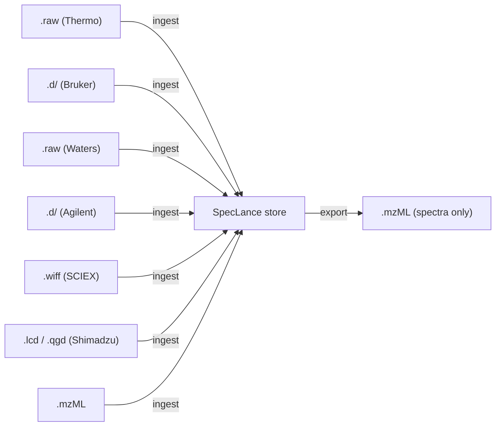

# SpecLance

[](https://github.com/Sigilweaver/SpecLance/actions/workflows/ci.yml)
[](https://github.com/Sigilweaver/SpecLance/blob/main/LICENSE)
[](https://www.rust-lang.org)

> Part of the [OpenMassSpec](https://sigilweaver.app/openmassspec/docs/)
> stack for mass spectrometry raw-file access. SpecLance is the columnar
> storage layer; vendor readers feed it through
> [openmassspec-io](https://github.com/Sigilweaver/OpenMassSpec).

A fast, columnar, memory-mapped mass spectrometry data store powered by [Lance].

SpecLance is a **storage format**, not an analysis framework. It ingests mzML
and vendor raw files into a Lance store that is faster to read, cheaper to
seek, and can hold many runs in a single directory.

SpecLance is not a drop-in replacement for mzML: export is lossy (see
[Known issues](#known-issues)). Keep your source files.

## Status

Alpha. APIs and the on-disk schema may break without notice until 1.0.

Implemented:

- Ingest `.mzML` (streaming) into a store with `runs`, `spectra`, and
  `chromatograms` tables. Ingesting a file whose run is already in the store is refused (`Error::RunExists`, a Python
  `OSError`) and writes nothing.
- Ingest vendor raw data from all six formats `openmassspec-io` supports:
  Thermo `.raw`, Bruker timsTOF `.d`, Waters `.raw`, Agilent MassHunter
  `.d`, SCIEX `.wiff`, and Shimadzu LabSolutions `.lcd` / `.qgd`. Vendor
  ingest is off by default; build with `--features all-vendors`.
- Scalar indexes on `run_id`, `scan_num`, `rt`, and `ms_level`, and a
  retention-time window query (CLI `query`, Rust `Store::query_window`,
  Python `Store.query_window`).
- Export a run back to mzML (spectra only; see [Known issues](#known-issues)).
- Python bindings that return plain `dict` / `list` objects.

## Known issues

- **Export is lossy.** `speclance export` writes spectra only. It does not
  emit chromatograms, the stored `cv_params` blobs, or the verbatim
  `run_metadata` blocks. The output is a valid mzML for the spectra it
  carries, not a copy of the source.
- **MS-Numpress is not supported.** Ingest stops with an error on any
  Numpress-encoded array, in a spectrum or a chromatogram. Only uncompressed and zlib arrays are read.
- **`scan_num` does not always match the source.** For mzML ingest it is
  the spectrum `index` + 1, not the scan number in the nativeID. The
  original nativeID is kept in `native_id`.
- **`run_id` identifies a path and size, not content.** It is derived from the
  source path string and the file size, so the same file reached by a
  different path gets a different `run_id`.
- **Vendor ingest stores less than mzML ingest.** It writes no
  chromatograms and no `run_metadata`. Its `cv_params` hold only what does
  not fit a column (`openmassspec.collision_energies`, `openmassspec.scan_windows`,
  `openmassspec.warnings`). `scan_num` is the vendor's scan number rather than a
  spectrum index + 1.
- **Older vendor-ingested stores differ in three columns.** They wrote a missing retention time as 0 s, an energy
  of unknown unit (every Agilent Q-TOF MS/MS scan) as electronvolts, and the observed m/z range as the scan window.
  Re-ingest the file to get the current values.
- **Only m/z and intensity arrays are stored.** Other binary data arrays in an mzML spectrum or chromatogram (for
  example a per-peak ion mobility array) are not decoded. Each ingest counts them by array name and reports the count
  on stderr (CLI and Python), and records it in `runs.run_metadata` under `skipped_arrays`. The Python report is a plain
  stderr line, not a `warnings` warning, and an array marked as non-standard data (`MS:1000786`) is counted under its
  first term, not under its `value=` name.
- **Intensity is stored as Float32.** A 64-bit intensity array is narrowed on ingest.
- **Array precision is not used on export.** The writer does not read `mz_precision` or `intensity_precision`, and
  vendor ingest sets them to 64 and 32 rather than a source width.
- **Ion mobility is one value per spectrum.** There is no per-peak mobility column and no ingest option for how a
  Bruker frame maps to rows.
- **Drift time is not exported.** `inv_mobility` holds 1/K0 only. A scan-level drift time (`MS:1002476`) is kept in
  `cv_params`, and export does not write `cv_params`. Runs from older mzML ingests can hold a drift time in
  `inv_mobility`; nothing marks them. A file whose converter wrote a 1/K0 value under `MS:1002476` gets an empty
  `inv_mobility`; the value stays in `cv_params` and is not exported.
- **Vendor scan metadata without a column is dropped.** Thermo filter strings, Waters function types and Bruker
  accumulation times are not stored.
- **No spectrum-library adapters.** The Python API has no conversion to `spectrum_utils`, `matchms`, `ms2ml`,
  `pyOpenMS` or `pyteomics` objects.
- **Memory use.** mzML ingest reads the whole source file into memory, vendor ingest holds the whole run, and export
  loads every spectrum of the run.
- **Roundtrip tests are narrow.** They re-read the exported mzML with SpecLance's own reader and compare spectrum
  count and selected fields. There is no independent parser, and no fixture has Numpress arrays.
- **The Python package ingests mzML only.** Vendor ingest is in the CLI.
- **`query` reads one run at a time.** There is no cross-run query, XIC, or
  comparison command.
- **No m/z index or m/z query.** Queries filter on run, retention time, and
  MS level only.
- **No PyArrow / Polars output.** The Python API returns `dict`s and lists.
- All runs share one set of tables; there is no per-run dataset layout.
- mzML activation roundtrip is lossy in these cases:
  - Older vendor-ingested stores hold long activation names. The reader parses them (`parse_activation` accepts the
    short names, these long names and other PSI-MS term names), but `SID` and `HCD` share one long name and read as
    `HCD`, and `EThcD` and `ETD` share one and read as `ETD`.
  - `HCD` is written as `MS:1000422` (beam-type CID), so a file read with `MS:1002481` (higher energy beam-type CID),
    alone or together with `MS:1000422`, is written back with `MS:1000422` only.
  - ETD with `MS:1002678` (supplemental beam-type CID) reads as `EThcD` and is written back as ETD with `MS:1002631`
    (EThcD).
  - `MPD` and `MPID` both map to `MS:1000435` (photodissociation) and read back as `MPID`.
  - `CID` is written as `MS:1000133`; the supplemental terms `MS:1002678` and `MS:1002679` and any other activation
    term are kept in `cv_params` on read and are not written back.
  - A spectrum with an activation but no precursor cannot be written (`MsError::Unsupported`).
- After an interrupted ingest, rows of the unfinished run stay in the spectra table, and in the chromatograms table if
  the file has chromatograms, until the same file is ingested again; until then `read_spectra` and `query_window`
  return them.
- Two processes must not ingest the same file into the same store at once. Ingests are not coordinated: one can delete
  rows the other has written, which can leave a run row with missing spectra.

## Data flow



There are three usage modes:

1. **Ingest from vendor format.** `openmassspec-io` parses the proprietary
   files (Thermo, Bruker, Waters, Agilent, SCIEX, Shimadzu) and SpecLance
   writes the store. No vendor SDK, no Wine, no COM interop. Requires a
   build with `--features all-vendors`.
2. **Ingest from mzML.** Parse existing mzML files and write a SpecLance
   store. This is the zero-friction on-ramp for labs that already have mzML
   pipelines.
3. **Export to mzML.** Write a run from a SpecLance store back out as mzML.
   This carries spectra and their typed fields only; chromatograms, extra CV
   params, and run-level metadata are not written. The
   `mzML -> SpecLance -> mzML` roundtrip is not lossless (see
   [Known issues](#known-issues)).

## Why Not mzML?

mzML is the HUPO-PSI community standard and it is well-supported, but it has
structural properties that make it expensive at scale:

- It is XML, which means sequential parsing. Seeking to scan 50,000 out of
  200,000 requires either re-parsing from the start or maintaining an index
  file (mzML.index / mzMLb).
- Every peak array is Base64-encoded inline in the XML, which inflates size
  and requires a decode step before any numerical work.
- Cross-run queries (e.g., "all MS2 spectra with precursor 445.22 +/- 10 ppm
  across 40 LC-MS runs") require loading and parsing each file independently.
- Profile-mode Orbitrap runs routinely exceed 1 GB. TimsTOF PASEF runs can
  reach 10-20 GB per acquisition.

Lance stores data as Apache Arrow columns in memory-mapped files. Filtering
by retention time or MS level touches only the relevant columns, not the
peak arrays. A region scan that would require parsing an entire mzML file
can be answered by reading a fraction of the bytes.

## Architecture

```
speclance-core/     Arrow schema definitions, LanceDB table management,
                   shared types (Spectrum, Chromatogram, Run).

speclance-ms/       mzML reader (quick-xml) and writer, plus a vendor
                   adapter over openmassspec-io (feature `vendors` /
                   `all-vendors`). Each source is normalised into the
                   common speclance_core::Spectrum type.

speclance-cli/      `speclance` binary.
                     ingest   - write a SpecLance store from mzML or,
                                with --features all-vendors, vendor files;
                                refuses a run already in the store
                     runs     - list runs in a store
                     index    - build the default scalar indexes
                     query    - filter one run's spectra by RT / MS level
                     export   - write a run back to mzML (spectra only)

speclance-py/       Python bindings (PyO3 + maturin): Store.open,
                   ingest_mzml, create_default_indexes, runs,
                   query_window, chromatograms. mzML ingest only.
```

```bash
cargo build --release -p speclance-cli                          # mzML only
cargo build --release -p speclance-cli --features all-vendors   # + vendors
# the binary is target/release/speclance

speclance ingest --store ./store run.mzML
speclance index --store ./store
speclance runs --store ./store
speclance query --store ./store --run-id <id> --rt-min 30 --rt-max 35 --ms-level 2
speclance export --store ./store --run-id <id> --out out.mzML
```

## Schema

### `runs` table

One row per ingested file. All runs share the same three tables.

| column           | Arrow type | notes                                   |
|------------------|------------|-----------------------------------------|
| run_id           | Utf8       | SHA-256 of source path + size, first 16 hex digits |
| source_path      | Utf8       |                                         |
| source_format    | Utf8       | "mzml", "thermo-raw", "bruker-tdf", "waters-raw", "agilent-masshunter", "sciex-wiff", "shimadzu-labsolutions" |
| instrument       | Utf8       | instrument model name from CV / metadata|
| start_time       | Utf8       | ISO 8601                                |
| ingested_at      | Utf8       | ISO 8601, set at ingest                 |
| spectrum_count   | UInt32     |                                         |
| ms1_count        | UInt32     |                                         |
| ms2_count        | UInt32     |                                         |
| run_metadata     | Utf8 (JSON)| mzML header blocks; stored, not exported|

### `spectra` table

One row per spectrum. Peak data lives in list-typed columns so each spectrum
is self-contained and can be retrieved atomically.

| column                   | Arrow type          | notes                             |
|--------------------------|---------------------|-----------------------------------|
| run_id                   | Utf8                |                                   |
| scan_num                 | UInt32              | 1-based; mzML: index + 1          |
| native_id                | Utf8                | mzML nativeID string              |
| ms_level                 | UInt8               | 1, 2, ...                         |
| rt                       | Float64             | seconds                           |
| tic                      | Float64             | total ion current                 |
| base_peak_mz             | Float64             |                                   |
| base_peak_intensity      | Float64             |                                   |
| polarity                 | Int8                | +1 / -1                           |
| centroided               | Boolean             | centroid vs. profile mode         |
| precursor_mz             | Float64             | null for MS1                      |
| precursor_charge         | Int8                | null for MS1                      |
| precursor_intensity      | Float64             | null for MS1                      |
| isolation_window_target  | Float64             | null for MS1                      |
| isolation_window_lower   | Float64             | null for MS1                      |
| isolation_window_upper   | Float64             | null for MS1                      |
| activation               | Utf8                | HCD / CID / ECD / ETD / ...       |
| collision_energy         | Float32             | eV; null if not one energy in eV  |
| inv_mobility             | Float64             | 1/K0 (`MS:1002815`); null if none  |
| mz_precision             | UInt8               | 32 or 64 - source array width     |
| intensity_precision      | UInt8               | 32 or 64 - source array width     |
| scan_window_lower        | Float64             | instrument acquisition range      |
| scan_window_upper        | Float64             | instrument acquisition range      |
| mz                       | LargeList<Float64>  | peak m/z values                   |
| intensity                | LargeList<Float32>  | peak intensity values             |
| cv_params                | Utf8 (JSON)         | other CV params; not exported     |

### `chromatograms` table

mzML documents routinely include chromatogram traces (TIC, BPC, SRM/MRM
transitions). These are structurally separate from spectra in the mzML schema.
They are stored on mzML ingest and are not written on export.

| column         | Arrow type         | notes                                  |
|----------------|--------------------|----------------------------------------|
| run_id         | Utf8               |                                        |
| chrom_id       | Utf8               | mzML id attribute                      |
| chrom_type     | Utf8               | TIC / BPC / SRM / ...                  |
| precursor_mz   | Float64            | null for TIC/BPC                       |
| product_mz     | Float64            | null for TIC/BPC                       |
| time           | LargeList<Float32> | time axis, in the source unit          |
| intensity      | LargeList<Float32> | intensity axis                         |
| cv_params      | Utf8 (JSON)        | all chromatogram-level CV params       |

## Implementation Notes

How the store handles the parts of mzML that do not map to a typed column.
Gaps against a lossless roundtrip are listed in [Known issues](#known-issues).

### 1. CV terms

Typed Arrow columns hold the terms researchers filter on: MS level, retention
time, TIC, base peak, polarity, centroid flag, the precursor fields,
activation, collision energy, `inv_mobility`, the scan window and the array
precision. On mzML ingest, every other `cvParam` and `userParam` of a spectrum
is serialized as JSON into `spectra.cv_params`, together with the XML section
it appeared in; the column is null when there are none. Activation terms that
the `activation` name accounts for are not repeated there. Vendor ingest keeps in it only what no column holds
(`openmassspec.collision_energies`, `openmassspec.scan_windows`, `openmassspec.warnings`).

At the run level, `runs.run_metadata` holds the XML text of the mzML header
(everything before `<spectrumList>`, which includes `<fileDescription>`,
`<sampleList>`, `<softwareList>`, `<scanSettingsList>`,
`<instrumentConfigurationList>` and `<dataProcessingList>`) and of the footer,
as a JSON object with the keys `prefix`, `spectrum_list_open`, `inter`,
`chromatogram_list_open`, `suffix` and `indexed`. The blocks are kept as text
and are not parsed. When the ingest skipped binary data arrays that are not
m/z or intensity, the object also has `skipped_arrays`, with the total
`count` and `by_array`, the count per array name. Vendor ingest leaves
`run_metadata` null.

Export builds the mzML from the typed columns through `openmassspec-core`. It
does not read `cv_params` or `run_metadata`.

### 2. Binary precision

`mz` is stored as Float64 and `intensity` as Float32. On mzML ingest,
`mz_precision` and `intensity_precision` record the width the source array
declared (32 or 64; 64 when it declares none). Vendor ingest records 64 and 32.
The writer does not read these columns. MS-Numpress arrays are not supported:
ingest returns `MsError::Unsupported`.

### 3. Ion mobility

Each spectrum row has one `inv_mobility` value (Float64) and the schema has no
per-peak mobility column. `inv_mobility` is the inverse reduced ion mobility
1/K0 in V s/cm^2. mzML ingest reads it from the scan-level cvParam `MS:1002815`
(inverse reduced ion mobility), which is what `openmassspec-core` writes for a
Bruker scan. A scan-level `MS:1002476` (ion mobility drift time, in
milliseconds) is a different quantity, so it is not stored in `inv_mobility`;
it stays in `cv_params` with its value and unit. A `MS:1002815` value that is
not a number also stays in `cv_params`. Export writes `inv_mobility` as
`MS:1002815` and does not write `cv_params`, so a drift time is not exported.
Vendor ingest copies the value
`openmassspec-io` returns, so Bruker rows are whatever frame or PASEF
precursor records that crate produces. There is no ingest option to choose
between collapsing and expanding the mobility dimension.

### 4. Chromatograms

mzML `<chromatogramList>` traces (TIC, BPC, SRM/MRM) are separate from the
spectrum list. On mzML ingest each `<chromatogram>` is parsed into the
`chromatograms` table (see above); vendor ingest produces none. Export writes
no `<chromatogramList>` because the `openmassspec-core` writer is
spectrum-only.

### 5. Data processing lineage

The `<dataProcessingList>` of an mzML file is stored as part of the
`run_metadata` header text. It is not parsed and export does not write it.

### 6. Vendor metadata

Vendor ingest maps the `SpectrumRecord` fields that have a column (see the
`spectra` table) and nothing else. Thermo filter strings, Waters function
types and Bruker accumulation times have no column and are not stored.

### 7. Python

The [Python API](https://sigilweaver.app/speclance/docs/guide/python-api)
returns `dict`s whose `mz` and `intensity` are lists of floats. There are no
adapters to the spectrum objects of `spectrum_utils`, `matchms`, `ms2ml`,
`pyOpenMS` or `pyteomics`; the caller converts the lists.

### 8. Large files

mzML ingest reads the whole source file into memory, then parses spectra one at
a time and appends them to the store in batches of 2,048 (CLI and Python).
Vendor ingest is buffered: `openmassspec-io` returns the whole run in memory,
which is then appended in batches of 2,048. Export loads every spectrum of the
run into memory before writing.

## Dependency Map

```
speclance-core
  lancedb, arrow-array, arrow-schema, serde_json, anyhow, thiserror

speclance-ms
  speclance-core
  openmassspec-io  (mzML writer; vendor readers behind `vendors`)
  quick-xml        (mzML ingest)
  base64, flate2   (binary array decoding)

speclance-cli
  speclance-core, speclance-ms
  clap, tokio, indicatif

speclance-py  (maturin crate)
  speclance-core, speclance-ms
  pyo3
```

No vendor SDK, no Wine, no COM server, no proprietary runtime dependency of
any kind.

## Relation to Existing Projects

| project    | role                                              |
|------------|---------------------------------------------------|
| openmassspec-io | Vendor dispatch and mzML writer; all vendor ingest goes through it |
| OpenTFRaw  | Thermo .raw parser (via openmassspec-io)          |
| OpenTimsTDF    | Bruker timsTOF parser (via openmassspec-io)   |
| OpenWRaw   | Waters MassLynx parser (via openmassspec-io)      |
| OpenARaw   | Agilent MassHunter parser (via openmassspec-io)   |
| OpenSXRaw  | SCIEX .wiff parser (via openmassspec-io)          |
| OpenSZRaw  | Shimadzu LabSolutions parser (via openmassspec-io)|
| BioLance   | Conceptual template (VCF -> Lance); sibling project|
| SpecLance   | Storage layer; delegates parsing to the above     |

[Lance]: https://lancedb.github.io/lance/
